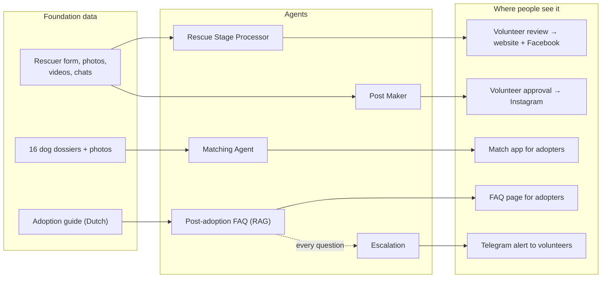

# RescueAI: AI agents for Dogs on a Journey

Team 50 project for **Mastering Agentic AI** (The Gen Academy, October 2026 cohort).

[Dogs on a Journey](https://www.dogsonajourney.com) is a volunteer-led foundation. It rehomes rescue dogs
from North Macedonia, Serbia and Romania with families in the Netherlands. Volunteers spend many hours
on repetitive work. RescueAI gives each slow, manual step of a dog's journey its own agent.
**Agents draft, rank, answer and flag. Volunteers review, decide and publish.**

### ▶ Start here: **[liajohn18.github.io/RescueAI_match_test](https://liajohn18.github.io/RescueAI_match_test/)**

This page has the Match app, with links to the Post-adoption FAQ (with Escalation) and the Post Maker demo.

## The agents

| Stage | Agent | What it does | Try it | Code |
|---|---|---|---|---|
| Profile | **Rescue Stage Processor** | Turns a rescuer's form, photos, videos and chat screenshots into an evidence-based profile. Then it writes 8 drafts: 3 Dutch and 3 English website versions, and a Facebook post in each language. | Runs locally (Streamlit, read-only Google Drive) | [shyampaul11/rescue-story-agent](https://github.com/shyampaul11/rescue-story-agent) |
| Profile | **Post Maker** | Picks the best real photos, builds 3 Instagram collage options and a Dutch caption. After a named volunteer approves, it makes a short collage video. | [Live demo](https://john1919.github.io/dog-post-maker/) | [john1919/dog-post-maker](https://github.com/john1919/dog-post-maker) |
| Match | **Matching Agent** | Asks the adopter 5 short questions, then shows swipe cards ranked by each dog's documented fit. It never guesses temperament or breed from a photo. | [Live app](https://anshulgoyl.github.io/RescueAI_match/) | [anshulgoyl/RescueAI_match](https://github.com/anshulgoyl/RescueAI_match) |
| First weeks | **Post-adoption FAQ** | Answers adopter questions in Dutch or English from the foundation's adoption guide (RAG), with a link to the exact guide page. | [Live FAQ](https://liajohn18.github.io/RescueAI_match_test/faq.html) | Frontend: [liajohn18/RescueAI_match_test](https://github.com/liajohn18/RescueAI_match_test) · API: [liajohn18/RescueAI-post-adoption-api](https://github.com/liajohn18/RescueAI-post-adoption-api) |
| First weeks | **Escalation** | Checks every FAQ question (none / urgent / emergency). For urgent cases it creates a ticket and alerts volunteers on Telegram. The adopter sees the right phone number at once. | Ask the [Live FAQ](https://liajohn18.github.io/RescueAI_match_test/faq.html) an urgent question | `escalation/` in [RescueAI-post-adoption-api](https://github.com/liajohn18/RescueAI-post-adoption-api) |

> The FAQ API runs on Render's free plan. The first question after a quiet period can take up to a minute.

## How it fits together

## Autonomy

Each agent follows a fixed workflow, and the AI decides only inside clear limits. People make every
decision that affects a dog: what gets published, who adopts, what medical advice is given and how
an urgent case is handled. Nothing is posted automatically.

## Evals

| What we measured | Result |
|---|---|
| Escalation: urgent and emergency cases caught (44 Dutch + English test questions) | **24 / 24** |
| Escalation: false alarms on routine and "what if" questions | **0 / 20** |
| FAQ: questions matched to the right guide section | **20 / 20** |
| Automated tests: Profile Processor 598 · Post Maker 69 · Matching Agent 18 · Escalation 12 | **697** |

Our test sets are small and written by us. Next step: test on real, anonymised adopter messages.

## Built with

OpenAI models · Python · Streamlit · FastAPI on Render · GitHub Pages · Telegram Bot API ·
built with Codex, Claude Code and VS Code.

## Team

Anshul Goyal · Lia John · Shyam Sundar Manivannan · Sunish John · Abdul Kader

## Safety and privacy

No API keys or private records are stored in these repositories. The Profile Processor uses
read-only Google Drive access. We are in touch with the foundation and plan to introduce the
tools step by step, with volunteer feedback.
